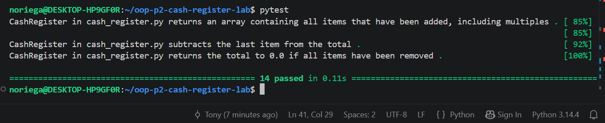

# Python OOP Lab: Cash Register

A `CashRegister` class that simulates a cash register for an e-commerce site. It tracks items, totals, discounts and past transactions.

## Features

- **Attributes:** `discount`, `total`, `items`, `previous_transactions`
- **Discount validation:** `discount` must be an integer from 0 to 100. Otherwise it prints `Not valid discount`. It defaults to 0.
- **`add_item(item, price, quantity=1)`:** adds `price × quantity` to the total, adds the item to `items`, and records the transaction.
- **`apply_discount()`:** takes the discount percentage off the total and prints the new total. If there is no discount, it prints `There is no discount to apply.`
- **`void_last_transaction()`:** removes the last transaction, its items, and its cost from the total.

## Setup

```
pipenv install
pipenv shell
```

## Running the tests

```
pytest
```

## Example usage

```python
from lib.cash_register import CashRegister

register = CashRegister(20)
register.add_item("macbook air", 1000)
register.apply_discount()  # After the discount, the total comes to $800.
```

## Screenshot of completed work

All 14 tests pass:

